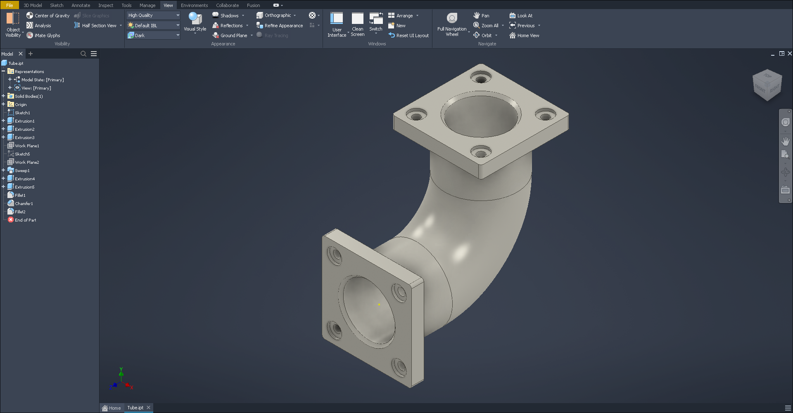
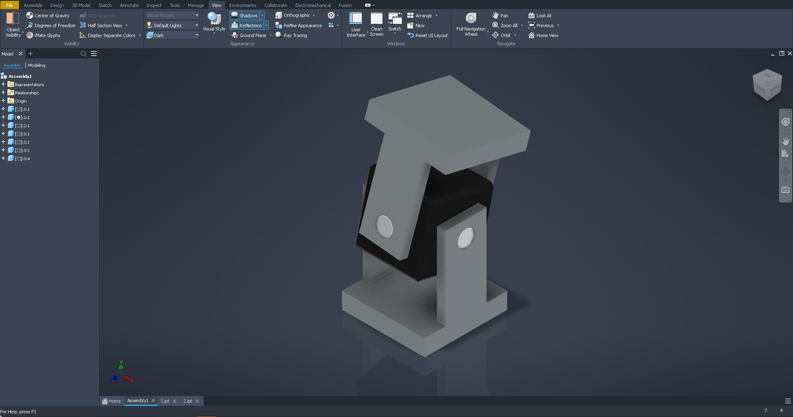
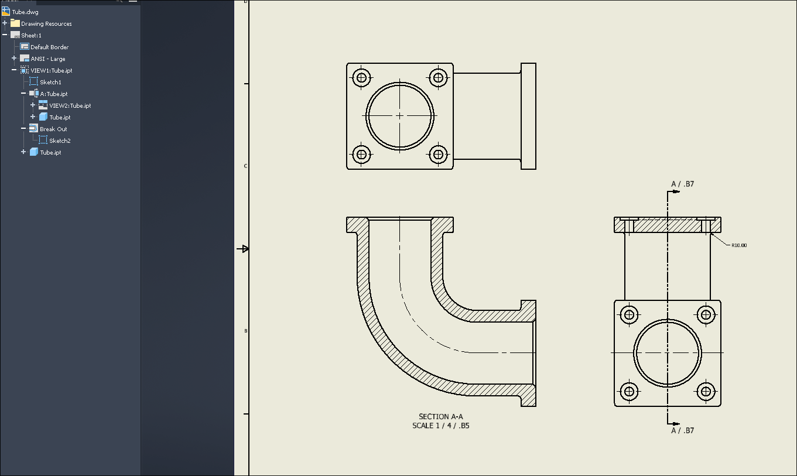
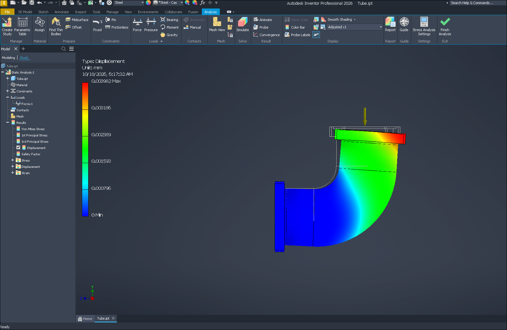

# Autodesk Inventor 2026 on Linux

Install and run **Autodesk Inventor Professional 2026** on Linux with Wine -
from Autodesk's own download, without Windows or a virtual machine, with one
command.

> **Status: early release (v0.1), in active development.** Works for everyday
> part, assembly, drawing and Content Center work, iLogic and Stress Analysis
> on **Arch Linux + Hyprland** (tested on two machines: AMD RX 580, and an
> Intel UHD 630 + NVIDIA GTX 1050 laptop). More distributions and an easier
> installer are planned - see [Roadmap](#roadmap). Reports are welcome.
>
> This is an unofficial community project. It is not made, supported or
> endorsed by Autodesk. You need your own Inventor license (an education
> license works). See [Disclaimer](#disclaimer).

**Quick start** (details in [Installation](#installation)):

```bash
git clone https://github.com/Harvi654/Autodesk-Inventor-for-Linux.git ~/inventor-on-linux
cd ~/inventor-on-linux
bash scripts/install.sh ~/Downloads/Inventor     # the folder with Autodesk's download
```

<table>
  <tr>
    <td></td>
    <td></td>
  </tr>
  <tr>
    <td align="center">Part modelling</td>
    <td align="center">Assembly with Content Center parts</td>
  </tr>
  <tr>
    <td></td>
    <td></td>
  </tr>
  <tr>
    <td align="center">Drawing with a section view</td>
    <td align="center">Stress Analysis</td>
  </tr>
</table>

## What works

| | Status | Notes |
|---|---|---|
| Installation from Autodesk's download | ✅ | Autodesk's own installers run under Wine; no Windows needed |
| Updates (e.g. 2026.4) | ✅ | |
| Sign-in and licensing | ✅ | in your normal web browser |
| Home page, New / Open | ✅ | |
| Sketch, dimensions, constraints | ✅ | |
| Part modelling (extrude, hole, ...) | ✅ | |
| Assemblies | ✅ | |
| Content Center (screws, nuts, profiles, ...) | ✅ | ~12.7 GB, installed by default |
| Design Accelerator (shafts, ...) | ✅ | |
| Materials and appearances | ✅ | |
| 3D view (Direct3D 11 via DXVK) | ✅ | |
| Drawings (views, sections) | ✅ | |
| Dimension text editor in drawings | ✅ | symbols, GD&T and the symbol palette as on Windows |
| Export STEP, STL, PDF | ✅ | samples in [docs/examples](docs/examples) |
| iLogic | ✅ | rules, parameters driving the model |
| Stress Analysis (mesh, simulate, results, animation) | ✅ | |
| Frame Analysis, Dynamic Simulation | ⚠️ | off by default, untested - `bash scripts/addins.sh enable NAME` |
| GPU ray tracing | ❌ | needs Direct3D 12 ray tracing |

Found something that does not work? See [Reporting problems](#reporting-problems).

## Requirements

- **Arch Linux** (or a derivative with `pacman`), Wayland or X11
- tested desktops: **Hyprland** and **KDE Plasma** (Wayland); others will likely work too
- a GPU with **Vulkan** drivers (AMD/Intel: Mesa; NVIDIA: the proprietary driver)
- **~60 GB** free disk space (Inventor + Content Center + the unpacked download)
- an Autodesk account with an Inventor 2026 license
- about an hour, most of it waiting (the first build of the Wine fixes takes 10-30 minutes)

## Installation

### 1. Download Inventor from Autodesk

In your Autodesk account (Products and Services → Inventor Professional 2026)
pick your language and choose **Browser download** (not "Install"). You get a
small `..._001_002.exe` and a large `..._002_002.7z`. Put both in one folder,
e.g. `~/Downloads/Inventor`.

Recommended: from the **Updates** tab download the latest Inventor 2026 update
into the same folder.

You do **not** need the "Install" web installer or the `Create_Installer_*.exe`
tools - they are for Windows.

### 2. Get this project

```bash
git clone https://github.com/Harvi654/Autodesk-Inventor-for-Linux.git ~/inventor-on-linux
cd ~/inventor-on-linux
```

### 3. Install

```bash
bash scripts/install.sh ~/Downloads/Inventor
```

Run it as your normal user; it asks for your password when it needs `sudo`
(system packages, installing the Wine fixes, a pacman hook). Arch does not
support partial upgrades, so installing packages runs `pacman -Syu` - your
system is updated too. It installs the system packages (official Arch
repositories only), builds
this project's Wine fixes, unpacks the download, runs Autodesk's installers,
sets up the Wine prefix and adds Inventor to your app launcher.

If it stops, fix what it reports and run the same command again - finished
steps are skipped. The log is in `logs/install-*.log`.

Options: `--no-content` (leave out Content Center), `--prefix DIR`,
`--help` for the rest.

### 4. Hyprland only: window rules

On other desktops skip this step. Add to `~/.config/hypr/hyprland.conf`:

```
source = ~/inventor-on-linux/config/hyprland-inventor.conf
```

With a Lua config (`hyprland.lua`, Hyprland 0.55+) copy the contents of
`config/hyprland-inventor.lua` into it instead. Then `hyprctl reload`.

### 5. Start

Start **Autodesk Inventor 2026** from your app launcher, or:

```bash
bash ~/inventor-on-linux/scripts/launch-inventor.sh
```

The first start opens your browser for the Autodesk sign-in.

**Laptop with two GPUs:** check which one Inventor uses:

```bash
grep -hE "Creating device" -A1 ~/inventor-on-linux/logs/inventor-*.log | tail -2
```

If it is the integrated one, add part of the name of the GPU you want to
`~/inventor-on-linux/config.env`, e.g. `INV_GPU="GTX 1050"`.

### Keeping it working

- Update this project: `cd ~/inventor-on-linux && git pull`
- When Arch updates Wine, the Wine fixes are replaced by the new version's
  files and a pacman hook reminds you to rebuild them. Before starting
  Inventor run `bash ~/inventor-on-linux/scripts/rebuild-wine-fixes.sh`.

### Uninstall

```bash
bash ~/inventor-on-linux/scripts/uninstall.sh
```

Removes the launcher entry, the Wine fixes (Arch's `wine` package is
reinstalled) and, after asking, the Wine prefix. Your Inventor files in
`~/Inventor` are kept.

## FAQ

**Which license do I need?** Your own Inventor 2026 license - a paid
subscription or a free education license. Sign-in and licensing are Autodesk's
own, in your browser; nothing is bypassed.

**Does it need Windows or a virtual machine?** No. Autodesk's own download is
installed directly under Wine.

**Where are my files?** In `~/Inventor` (drive `D:` in Inventor). The Wine
prefix cannot see the rest of your home folder.

**Is it slow?** 3D runs through DXVK (Direct3D 11 on Vulkan) and feels like on
Windows on the tested machines. The first start after installing takes longer.

**Will Autodesk support it?** No - see [Disclaimer](#disclaimer). Report
problems here.

## How it works

Inventor itself is not modified. The work is in three places:

- **Wine fixes** (`patches/`): small patches for Wine bugs Inventor runs into -
  a missing WMI class, the file dialog's folder view, type libraries, MSI
  transforms and delta patches, COM details Stress Analysis needs, a sketch that only redrew on mouse movement,
  black boxes behind sketch inputs under Xwayland, a crash with some mouse
  devices. They are built from Wine's source for the Wine version you have
  installed and replace only the affected Wine files (originals are kept).
  They are meant to go to Wine upstream.
- **Installation** (`scripts/install-from-image.py`, `scripts/lib/odis.py`):
  reads Autodesk's install image and runs its packages in the right order
  under Wine, in place of Autodesk's Windows installer front end.
- **Prefix setup** (`scripts/finish-install.sh`): DXVK for Direct3D 11,
  WebView2 for the home page and sign-in, free fonts in place of Windows fonts,
  browser sign-in, and isolation of the Wine prefix from your home folder.

Details, background and every problem found on the way:
[docs/arch-hyprland.md](docs/arch-hyprland.md).

## Roadmap

Planned, roughly in this order:

- [ ] more testing on other hardware (NVIDIA-only, Intel-only, laptops)
- [ ] other distributions: Ubuntu / Debian, Fedora, openSUSE
- [ ] other desktops: KDE Plasma (Wayland) works in a first test, GNOME untested - Hyprland-specific parts are only window rules
- [ ] prebuilt Wine fixes, so nothing has to be compiled
- [ ] a simpler graphical installer
- [ ] send the Wine fixes to Wine upstream
- [ ] Frame Analysis, Dynamic Simulation, Inventor Studio, sheet metal - test and fix
- [ ] Inventor 2025 and 2027

## Reporting problems

Open an [issue](../../issues/new/choose) with:

1. what you did, step by step, and whether it happens every time,
2. a screenshot,
3. the report file from

   ```bash
   bash ~/inventor-on-linux/scripts/report.sh            # after a crash or a problem in Inventor
   bash ~/inventor-on-linux/scripts/report.sh --install  # when the installation failed
   ```

   It collects your system, GPU, Wine and Inventor versions and the end of the
   newest log into `~/inventor-report-<date>.txt`, with e-mail addresses,
   sign-in tokens and your user name removed. Read it before you send it.

## Disclaimer

Autodesk and Inventor are trademarks of Autodesk, Inc. This project is not
affiliated with or endorsed by Autodesk. It contains no Autodesk software and
does not change or bypass licensing: you install Autodesk's own download and
sign in with your own account and license. Running Inventor on Linux is not
supported by Autodesk; use it at your own risk, keep backups of your work, and
check that your license terms allow it.

The scripts are provided as they are, without warranty of any kind.

## Credits

This project started as a fork of
[cakelesscoder/inventor-on-linux](https://github.com/cakelesscoder/inventor-on-linux),
which first got Inventor 2026 running under Wine and found the
`Win32_TimeZone` fix (`patches/wbemprox-timezone.patch`).

Most of the code and the Wine patches in this fork were written with the help
of AI (Claude, by Anthropic) and tested by people on real machines.

## License

[MIT](LICENSE), like the original project. The files in `patches/` change
Wine's source code; when they are sent to Wine they are offered under Wine's
license (LGPL 2.1 or later).
