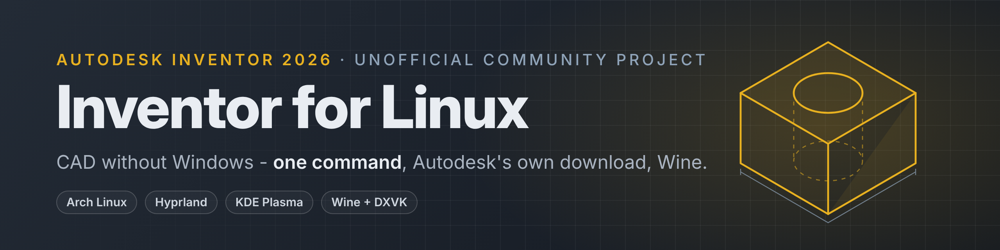

# Autodesk Inventor 2026 on Linux

Install and run **Autodesk Inventor Professional 2026** on Linux with Wine -
from Autodesk's own download, without Windows or a virtual machine, with one
command.

> **Status: early release (v0.2), in active development.** Works for everyday
> part, assembly, drawing and Content Center work, iLogic and Stress Analysis
> on **Arch Linux** with **Hyprland** or **KDE Plasma** (tested on two
> machines: AMD RX 580, and an Intel UHD 630 + NVIDIA GTX 1050 laptop - the
> laptop with a slightly older version). **Ubuntu 26.04** and **Fedora 44**
> install and run too (first tests, in a virtual machine). An easier
> installer is planned - see [Roadmap](#roadmap). Reports are welcome.
>
> This is an unofficial community project. It is not made, supported or
> endorsed by Autodesk. You need your own Inventor license (an education
> license works). See [Disclaimer](#disclaimer).

**Quick start** (details in [Installation](#installation)):

```bash
git clone https://github.com/Harvi654/Autodesk-Inventor-for-Linux.git ~/inventor-on-linux
cd ~/inventor-on-linux
bash scripts/install.sh ~/Downloads/Inventor     # the folder with Autodesk's download
```

<table>
  <tr>
    <td></td>
    <td></td>
  </tr>
  <tr>
    <td align="center">Part modelling</td>
    <td align="center">Assembly with constraints</td>
  </tr>
  <tr>
    <td></td>
    <td></td>
  </tr>
  <tr>
    <td align="center">Drawing with a section view</td>
    <td align="center">Stress Analysis</td>
  </tr>
</table>

## Demo

All videos are screen recordings on Arch Linux. Only "Creating a part" is sped up (2×); the others run in real time.

### Real-time viewport on Linux

https://github.com/user-attachments/assets/d64e236a-c817-4076-bee3-72428a7bc288

### Creating a part (2× speed)

https://github.com/user-attachments/assets/bacf2d9a-e9ee-46bd-b2d7-e32260b04905

### Creating an assembly

https://github.com/user-attachments/assets/a0b27cf0-6f8b-47d7-820c-8911989c78f7

### Stress Analysis – I-beam under load

https://github.com/user-attachments/assets/880c5111-3ad3-4582-8795-02d9e7b6050f

## What works

| | Status | Notes |
|---|---|---|
| Installation from Autodesk's download | ✅ | Autodesk's own installers run under Wine; no Windows needed |
| Updates (e.g. 2026.4) | ✅ | |
| Sign-in and licensing | ✅ | in your normal web browser |
| Home page, New / Open | ✅ | |
| Sketch, dimensions, constraints | ✅ | |
| Part modelling (extrude, hole, ...) | ✅ | |
| Assemblies | ✅ | |
| Content Center (screws, nuts, profiles, ...) | ✅ | ~12.7 GB, installed by default |
| Design Accelerator (shafts, ...) | ✅ | |
| Materials and appearances | ✅ | |
| 3D view (Direct3D 11 via DXVK) | ✅ | |
| Inventor 2027 (2027.1) | ✅ | install, sign-in, parts, assemblies, drawings, Stress Analysis; the installer picks the version from the download |
| 3D view in 2027: Direct3D 12 via vkd3d-proton | ✅ | Inventor 2027 picks DirectX 12 when it works (Application Options > Hardware); without vkd3d-proton it falls back to DirectX 11 and warns once |
| CPU ray tracing (View > Ray Tracing) | ✅ | runs on the processor - fans spin up, that is expected |
| Drawings (views, sections) | ✅ | |
| Dimension text editor in drawings | ✅ | symbols, GD&T and the symbol palette as on Windows |
| Export STEP, STL, PDF | ✅ | samples in [docs/examples](docs/examples) |
| iLogic | ✅ | rules, parameters driving the model |
| Stress Analysis (mesh, simulate, results, animation) | ✅ | |
| Sheet metal (face, flange, flat pattern, DXF export) | ✅ | |
| Dynamic Simulation | ✅ | joints, gravity, run and replay; the Simulation Player panel can end up behind the main window (Alt+Tab) |
| Frame Generator | ✅ | Insert Frame with Content Center profiles (since Wine build `wine-11.20-3`) |
| Frame Analysis | ❌ | study, constraints and loads work; Simulate crashes the solver (`rkernel.exe`) in Wine's compound-file code (ole32) - being looked into; off by default |
| 3D PDF (Anark) | ❌ | Publish crashes Anark's `corewrapper.exe` under wine-mono; off by default |
| Open dialog: clicking quickly through folders | ✅ | crashed Inventor 2026 and 2027 (.NET "Fatal error" while previews load) - fixed in Wine build `wine-11.20-4` (ntdll, XSAVE). 2027: no previews yet, folder names missing in the path bar |
| GPU ray tracing | ❌ | not yet: tested on an RX 6400 (RDNA 2) with Inventor 2027 - vkd3d-proton reports DXR 1.1, but Inventor still says the card is not supported and never loads its ray tracer; CPU ray tracing works |

Found something that does not work? See [Reporting problems](#reporting-problems).

## Requirements

- **Arch Linux** (or a derivative with `pacman`), **Ubuntu 26.04 / Debian**
  (`apt`) or **Fedora 44** (`dnf`) - Ubuntu and Fedora in first tests; Wayland or X11
- tested desktops: **Hyprland**, **KDE Plasma** and **GNOME** (Wayland); others will likely work too
- a GPU with **Vulkan** drivers (AMD/Intel: Mesa; NVIDIA: the proprietary driver)
- **~60 GB** free disk space (Inventor + Content Center + the unpacked download)
- an Autodesk account with an Inventor 2026 license
- about an hour, most of it waiting

## Installation

### 1. Download Inventor from Autodesk

Create a folder for the download, e.g. `~/Downloads/Inventor`. Then, signed in
at [manage.autodesk.com](https://manage.autodesk.com):

1. **Products and Services** → click **Inventor Professional**.
2. Choose version **2026** or **2027** and your **language** (English is the
   tested one).
3. Click the **arrow** next to the download button and pick **Direct
   download** (called *Browser download* in some versions) - not "Install".
4. Two files are downloaded - save both into the folder.
5. Recommended: in the same place, under the available downloads / updates,
   download the newest **Inventor Professional update** of that version
   (e.g. 2026.4 or 2027.1) into the same folder. Only the Inventor update -
   the Identity Manager, Licensing Service and Shared Components updates
   listed there are not needed.

The folder then looks like this (its name does not matter):

```
~/Downloads/Inventor/
├── Inventor_Professional_2026_English_Win_64bit_db_001_002.exe   16 MB    comes with the .7z
├── Inventor_Professional_2026_English_Win_64bit_db_002_002.7z    5.7 GB   required
└── Inventor_2026.4_Update.exe                                    1.3 GB   optional, recommended
```

- The two `..._db_...` files are one download: the `.7z` holds Inventor, the
  small `.exe` is the Windows unpacker (not used here, but keep it with the
  `.7z`). With another language, `English` in the names is different.
- Keep the downloaded names; don't unpack anything yourself - the installer
  does it (into `~/.cache/inventor-on-linux/media`, ~15 GB).
- An already unpacked install image (a folder with `setup.xml` /
  `manifest/`) works too.
- The installer reads the version from the file names: 2026 goes to
  `~/.wine-inventor2026`, 2027 to `~/.wine-inventor2027`. Both can be
  installed side by side; one download folder per version.
- You do **not** need the "Install" web installer or the
  `Create_Installer_*.exe` tools - they are for Windows. If they are in the
  folder, they are skipped.

### The easy way: one command

With the download from step 1 in your Downloads folder, run this in a terminal:

```bash
bash <(curl -fsSL https://raw.githubusercontent.com/Harvi654/Autodesk-Inventor-for-Linux/main/get.sh)
```

It installs `git` if needed, downloads this project into `~/inventor-on-linux`
(the newest release) and starts the graphical installer, which finds the
download, shows every phase with a progress bar and asks for your password in
a window. [`get.sh`](get.sh) is short - read it first if you like. Later,
**Inventor on Linux - Setup** in your app menu repairs or updates the
installation.

Or step by step:

### 2. Get this project

```bash
git clone https://github.com/Harvi654/Autodesk-Inventor-for-Linux.git ~/inventor-on-linux
cd ~/inventor-on-linux
```

### 3. Install

```bash
bash scripts/install.sh ~/Downloads/Inventor     # the folder from step 1
```

Run it as your normal user; it asks for your password when it needs `sudo`
(system packages only). Arch does not support partial upgrades, so installing
packages runs `pacman -Syu` - your system is updated too. It installs the
system packages (official Arch repositories only), downloads this project's
Wine (~220 MB, see [How it works](#how-it-works)), unpacks the download, runs
Autodesk's installers, sets up the Wine prefix and adds Inventor to your app
launcher.

If it stops, fix what it reports and run the same command again - finished
steps are skipped. The log is in `logs/install-*.log`.

Options: `--no-content` (leave out Content Center), `--prefix DIR`,
`--help` for the rest.

**Or with a window (new, being tested):**

```bash
bash scripts/install-gui.sh
```

The same installation with a window: it checks your system, finds Autodesk's
download in your Downloads folder, shows the eight phases with a progress bar
and the installer's output, and asks for your password in a dialog. It needs
GTK 4 for Python and installs it first if it is missing. With Inventor already
installed it offers to start it, repair the installation or update this
project and its Wine.

### 4. Hyprland only: window rules

On other desktops skip this step. Add to `~/.config/hypr/hyprland.conf`:

```
source = ~/inventor-on-linux/config/hyprland-inventor.conf
```

With a Lua config (`hyprland.lua`, Hyprland 0.55+) copy the contents of
`config/hyprland-inventor.lua` into it instead. Then `hyprctl reload`.

### 5. Start

Start **Autodesk Inventor 2026** (or 2027) from your app launcher, or:

```bash
bash ~/inventor-on-linux/scripts/launch-inventor.sh
```

With several versions installed, choose one by its prefix - the version is
read from it:

```bash
INV_PREFIX=~/.wine-inventor2027 bash ~/inventor-on-linux/scripts/launch-inventor.sh
```

The first start opens your browser for the Autodesk sign-in.

**Laptop with two GPUs:** check which one Inventor uses:

```bash
grep -hE "Creating device" -A1 ~/inventor-on-linux/logs/inventor-*.log | tail -2
```

If it is the integrated one, add part of the name of the GPU you want to
`~/inventor-on-linux/config.env`, e.g. `INV_GPU="GTX 1050"`.

### Keeping it working

- Update this project: `cd ~/inventor-on-linux && git pull`
- Inventor runs on this project's own Wine in `~/.local/share/inventor-on-linux`,
  so Arch's Wine updates don't affect it, and other Wine programs don't use it.
  When a `git pull` brings a newer build, the launcher tells you; then run
  `bash ~/inventor-on-linux/scripts/get-wine.sh`.
- Installed with v0.1 (fixes copied into the system's Wine)? Run
  `bash scripts/get-wine.sh` once to switch; `sudo pacman -S wine` puts Arch's
  original Wine back. `INV_WINE=system` in `config.env` keeps the old way
  (then `scripts/rebuild-wine-fixes.sh` after every Wine update).

### Uninstall

```bash
bash ~/inventor-on-linux/scripts/uninstall.sh
```

Removes the launcher entry, this project's Wine (and fixes copied into the
system's Wine by v0.1, by reinstalling Arch's `wine` package) and, after
asking, the Wine prefix. Your Inventor files in
`~/Inventor` are kept.

## FAQ

**Which license do I need?** Your own Inventor 2026 license - a paid
subscription or a free education license. Sign-in and licensing are Autodesk's
own, in your browser; nothing is bypassed.

**Does it need Windows or a virtual machine?** No. Autodesk's own download is
installed directly under Wine.

**Where are my files?** In `~/Inventor` (drive `D:` in Inventor). The Wine
prefix cannot see the rest of your home folder.

**Is it slow?** 3D runs through DXVK (Direct3D 11 on Vulkan) and feels like on
Windows on the tested machines. The first start after installing takes longer.

**Is it safe to run?** Read the scripts first - they are plain bash and
Python, no compiled programs are in this repository. What they do:

- `sudo` is used only for `pacman` (packages from the official Arch
  repositories). Nothing outside your home folder is changed otherwise.
- Downloads: this project's Wine from its GitHub releases - built in public
  by the [Build Wine](.github/workflows/build-wine.yml) workflow from Wine's
  source and `patches/`, checked against the SHA-256 in `wine/SHA256SUMS`
  (you can build it yourself instead: `scripts/get-wine.sh --build`), DXVK
  2.7.1 and vkd3d-proton 3.0.1 from their GitHub releases (SHA-256 checked)
  and Microsoft's WebView2
  runtime. Inventor itself comes only from your own Autodesk download.
- Everything else stays in your home folder: the Wine prefix
  (`~/.wine-inventor2026`), this project's Wine, the launcher entry.
  Telemetry add-ins are switched off.
- `scripts/uninstall.sh` undoes it.

**Will Autodesk support it?** No - see [Disclaimer](#disclaimer). Report
problems here.

## How it works

Inventor itself is not modified. The work is in three places:

- **Wine fixes** (`patches/`): small patches for Wine bugs Inventor runs into -
  a missing WMI class, the file dialog's folder view, type libraries, MSI
  transforms and delta patches, COM details Stress Analysis needs, a sketch
  that only redrew on mouse movement, a home page that lagged behind the mouse,
  black boxes behind sketch inputs under Xwayland, a crash with some mouse
  devices. They are applied to vanilla Wine (version in `wine/version.env`)
  and built into this project's Wine by a public GitHub workflow
  (`scripts/build-wine.sh`); the result is installed in your home folder, next
  to - not over - the system's Wine.
  They are meant to go to Wine upstream.
- **Installation** (`scripts/install-from-image.py`, `scripts/lib/odis.py`):
  reads Autodesk's install image and runs its packages in the right order
  under Wine, in place of Autodesk's Windows installer front end.
- **Prefix setup** (`scripts/finish-install.sh`): DXVK for Direct3D 11,
  vkd3d-proton for Direct3D 12 (Inventor 2027 checks for it),
  WebView2 for the home page and sign-in, free fonts in place of Windows fonts,
  browser sign-in, and isolation of the Wine prefix from your home folder.

Details, background and every problem found on the way:
[docs/arch-hyprland.md](docs/arch-hyprland.md).

## Roadmap

Planned, roughly in this order:

- [ ] more testing on other hardware (NVIDIA-only, Intel-only, laptops)
- [x] Ubuntu / Debian (Ubuntu 26.04 installs and runs - first test in a VM)
- [x] Fedora (Fedora 44 Workstation installs and runs - first test in a VM)
- [ ] openSUSE
- [ ] other desktops: KDE Plasma and GNOME (Wayland) work in first tests - Hyprland-specific parts are only window rules
- [x] prebuilt Wine with the fixes, so nothing has to be compiled (v0.2)
- [ ] a simpler graphical installer
- [ ] send the Wine fixes to Wine upstream
- [ ] Frame Analysis, 3D PDF, Inventor Studio, weldments, tube & pipe, cable & harness - test and fix
- [x] Inventor 2027 (2027.1 - first test on Arch)
- [ ] Inventor 2025

## Reporting problems

Open an [issue](https://github.com/Harvi654/Autodesk-Inventor-for-Linux/issues/new/choose) with:

1. what you did, step by step, and whether it happens every time,
2. a screenshot,
3. the report file from

   ```bash
   bash ~/inventor-on-linux/scripts/report.sh            # after a crash or a problem in Inventor
   bash ~/inventor-on-linux/scripts/report.sh --install  # when the installation failed
   ```

   It collects your system, GPU, Wine and Inventor versions and the end of the
   newest log into `~/inventor-report-<date>.txt`, with e-mail addresses,
   sign-in tokens and your user name removed. Read it before you send it.

Please report problems **here, not to WineHQ**: this project runs Wine with
its own patches, and Wine's bug tracker only takes reports from unmodified
Wine. Fixes that belong in Wine are sent there by this project.

## Disclaimer

Autodesk and Inventor are trademarks of Autodesk, Inc. This project is not
affiliated with or endorsed by Autodesk. It contains no Autodesk software and
does not change or bypass licensing: you install Autodesk's own download and
sign in with your own account and license. Running Inventor on Linux is not
supported by Autodesk; use it at your own risk, keep backups of your work, and
check that your license terms allow it.

The scripts are provided as they are, without warranty of any kind.

## About this project

This is a hobby project, made out of enthusiasm - I am a fan of Linux and of
the Wine project, and I wanted to use Inventor on Linux without a virtual
machine. Nobody pays for it and it is not connected to any company.

It is only possible thanks to the people who build, for free and in the open,
what it stands on: **Wine**, **DXVK** and **vkd3d-proton** first of all, and Mesa / the Vulkan
drivers, Arch Linux, Hyprland and KDE. And thanks to **AI** - most of the code
and the Wine patches were worked out together with Claude (Anthropic), which
made a project like this doable for one person in their free time.

Thank you all.

## Credits

This project started as a fork of
[cakelesscoder/inventor-on-linux](https://github.com/cakelesscoder/inventor-on-linux),
which first got Inventor 2026 running under Wine and found the
`Win32_TimeZone` fix (`patches/wbemprox-timezone.patch`).

Most of the code and the Wine patches in this fork were written with the help
of AI (Claude, by Anthropic) and tested by people on real machines.

## License

[MIT](LICENSE), like the original project. The files in `patches/` change
Wine's source code; when they are sent to Wine they are offered under Wine's
license (LGPL 2.1 or later).
