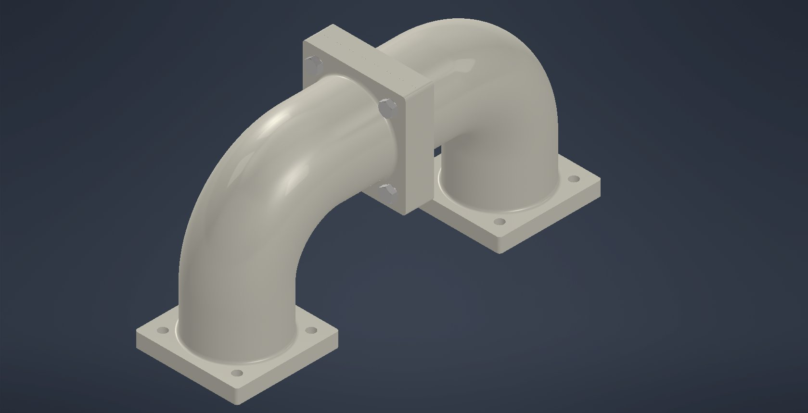

# Example exports

Made with Inventor 2026.4 running under Wine on Arch Linux + Hyprland with this
project: two flanged pipe elbows (the part from the README screenshot) bolted
together in an assembly with Content Center bolts and nuts, then exported.

| File | Export |
|---|---|
| `flanged-pipe-assembly.stp` | STEP AP214 (File → Export → CAD Format) |
| `flanged-pipe-assembly.stl` | STL, binary (File → Export → CAD Format) |
| `flanged-pipe-assembly.pdf` | PDF of the drawing (File → Export → PDF) |

