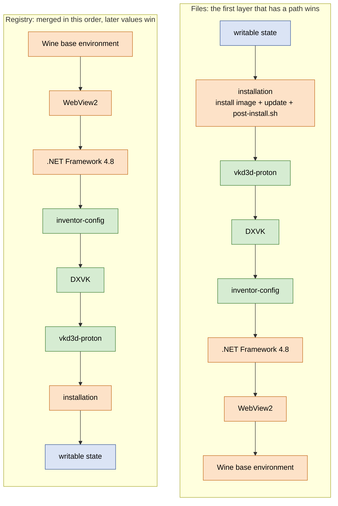
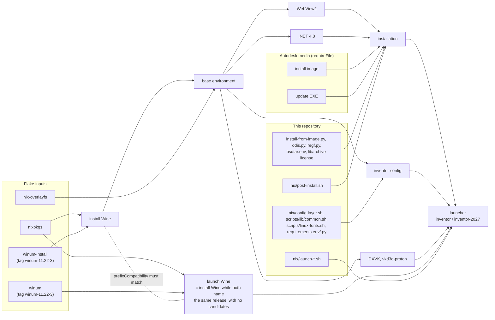

# Layers and dependencies of the Nix package

This page shows how `nix/inventor.nix` and `flake.nix` put Inventor together,
and what a change to each input rebuilds. Background: [AGENTS.md](AGENTS.md),
[../docs/nixos.md](../docs/nixos.md) ("Installation layer").

## What the launcher mounts

At launch, nix-overlayfs stacks read-only layers from the Nix store under one
writable layer per release (`~/.local/share/autodesk-inventor-<year>`). Files
and registry are combined in different orders
(nix-overlayfs `lib/mkOverlayfsPackage.nix`):

Orange layers are expensive to rebuild (the installation takes hours); green
ones are small and rebuild in minutes.

This has two consequences:

- The writable state's registry is merged three-way. nix-overlayfs keeps a
  record of what the layers provided at the last merge. A value that the
  user never changed follows the layers, so a changed packaged value (a new
  Shared Components version, a changed setting in `inventor-config`)
  reaches existing users. A value that the user changed, added or deleted
  is kept. The launcher writes no registry values (nix/AGENTS.md).
- The installation's files and registry win over `inventor-config`, DXVK and
  vkd3d-proton where both have the same file or value. The layers are kept
  disjoint.

The installation is one layer on purpose: nix-overlayfs drops
`windows/Installer` (the MSI cache that an MSP update patches against) from a
captured layer, and its builds cannot record files deleted from a lower
layer. An update built as a separate layer would therefore fail, or bring
back the files it removes.

## What is built from what

The launch Wine must make the same prefix as the install Wine, or evaluation
stops. The two are compared by `prefixCompatibility` in `nix/wine.nix`: the
winum release plus a hash of the release and candidate patches that change
prefix contents. The same rule applies to a winum checkout given as `winum`
to test candidates.

## What a change rebuilds

| Change | Rebuilds |
|---|---|
| `scripts/` other than the files below, docs | nothing (the `installer` check reruns the unit tests) |
| `common.sh`, `linux-fonts.sh`, `requirements.env`, `requirements.py`, `nix/config-layer.sh` | inventor-config, launcher |
| `nix/launch-*.sh`, DXVK or vkd3d-proton version | launcher (and that layer) |
| a code-only winum candidate under test | launch Wine, launcher |
| `winum` alone, to a release with the same `prefixCompatibility` | launch Wine, launcher (today only the same release qualifies) |
| new Autodesk update | **installation**, launcher |
| `install-from-image.py`, `odis.py`, `regf.py`, `bsdtar.env`, the libarchive license, `nix/post-install.sh` | **installation**, launcher |
| `nixpkgs`, `nix-overlayfs`, `winum-install` | everything from Wine up, **installation** included |

The changes in the bold rows reinstall Inventor, which takes hours. Those
inputs change often, so update them on purpose and in batches.
